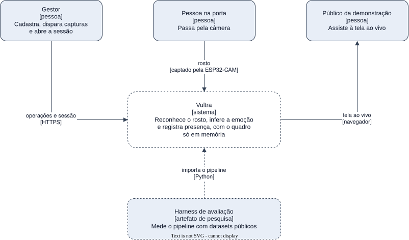

# Arquitetura

O mapa do sistema decidido nos ADRs [0001](../decisions/0001-stack-do-backend.md),
[0002](../decisions/0002-stack-do-frontend.md) e [0003](../decisions/0003-repositorio-e-infraestrutura.md).
Nada dele está construído ainda. Cada elemento traz o estágio que o constrói (E1 ou E2), e nos
diagramas o que ainda não existe aparece tracejado.

## Objetivo

Reconhecer quem passa por uma ESP32-CAM na porta da sala, inferir a expressão facial no mesmo quadro e
registrar o evento, com o quadro existindo apenas em memória. Na demonstração, uma sessão de chamada
transforma esses eventos em presença numa tela ao vivo. O sistema é o objeto que o artigo da Iniciação
Científica mede.

As metas de qualidade são os requisitos não funcionais do SRS:
[segurança](../requirements/non-functional/security.md),
[desempenho](../requirements/non-functional/performance.md),
[confiabilidade](../requirements/non-functional/reliability.md),
[flexibilidade](../requirements/non-functional/flexibility.md) e
[interação](../requirements/non-functional/interaction.md).

## Restrições

Estão na seção Restrições da [visão geral dos requisitos](../requirements/overview.md#restricoes).

## Contexto

| Ator ou sistema | O que troca com o Vultra |
| --- | --- |
| Gestor | Cria pessoas, registra câmeras, dispara capturas, revoga cadastros e abre a sessão de chamada, por HTTPS |
| Pessoa na porta | O rosto, capturado pela ESP32-CAM |
| Público da demonstração | Assiste à tela ao vivo da sessão |
| Harness de avaliação | Importa o pipeline do worker para medir datasets públicos. É artefato de pesquisa, fora do sistema |

## Estratégia de solução

| Escolha | Motivo | ADR |
| --- | --- | --- |
| API em NestJS sobre Fastify, no Node 26, com um módulo por área do SRS | O framework já traz validação, autenticação, autorização, gRPC, WebSocket e OpenAPI | [0001](../decisions/0001-stack-do-backend.md) |
| Inferência num worker Python separado, chamado por gRPC | As bibliotecas de visão são Python, e o quadro vai por chamada direta, sem passar por fila | [0001](../decisions/0001-stack-do-backend.md) |
| Câmera ligada à API por WebSocket sobre TLS | Uma conexão aberta recebe o comando de captura e devolve o quadro | [0004](../decisions/0004-canal-da-camera-por-websocket.md) |
| PostgreSQL com pgvector | A comparação 1:N acontece no banco | [0003](../decisions/0003-repositorio-e-infraestrutura.md) |
| Painel em Next.js que lê no servidor e escreve pela mesma origem | Login por cookie e tela ao vivo sem camada intermediária | [0002](../decisions/0002-stack-do-frontend.md) |
| Um Dockerfile por app, TLS na borda em produção | Os mesmos artefatos rodam nos dois ambientes | [0003](../decisions/0003-repositorio-e-infraestrutura.md) |

## Índice

| Seção | Onde |
| --- | --- |
| Blocos do sistema | [building-blocks/](building-blocks/README.md) |
| Cenários de execução | [runtime/](runtime/README.md) |
| Implantação e entrega | [deployment.md](deployment.md) |
| Conceitos transversais | [concepts/](concepts/README.md) |
| Decisões | [../decisions/](../decisions/README.md) |
| Requisitos de qualidade | [../requirements/](../requirements/README.md#nao-funcionais) |
| Riscos e dívida | [risks.md](risks.md) |
| Glossário | [../requirements/glossary.md](../requirements/glossary.md) |
