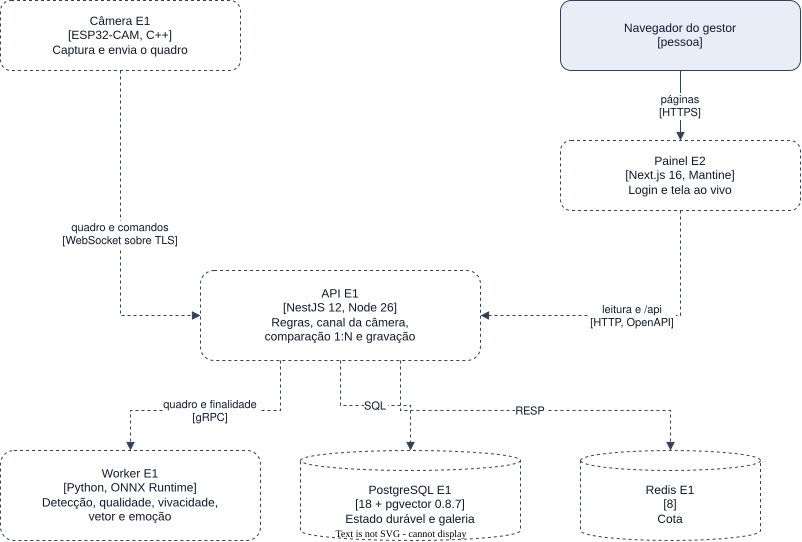

# Blocos do sistema

| Bloco | Tecnologia | Responsabilidade | Fala com (protocolo) | Estágio | Arquivo |
| --- | --- | --- | --- | --- | --- |
| Câmera | ESP32-CAM, firmware C++ | Captura o quadro e o envia | API (WebSocket sobre TLS) | E1 | [camera.md](camera.md) |
| API | NestJS 12, Node 26 | Regras, conexão das câmeras, comparação 1:N e gravação | Worker (gRPC), PostgreSQL (SQL), Redis (RESP) | E1 | [api.md](api.md) |
| Worker | Python 3.13, ONNX Runtime, InsightFace | Detecção, qualidade, vivacidade, vetor e emoção | ninguém: é chamado pela API | E1 | [worker.md](worker.md) |
| PostgreSQL | 18 com pgvector 0.8.7 | Pessoas, câmeras, vetores, eventos, sessões e auditoria | ninguém: é chamado pela API | E1 | [postgres.md](postgres.md) |
| Redis | 8 | Estado da cota | ninguém: é chamado pela API | E1 | [redis.md](redis.md) |
| Painel | Next.js 16, Mantine 9 | Login e tela ao vivo da sessão de chamada | API (HTTP, mesma origem por `/api`) | E2 | [web.md](web.md) |
