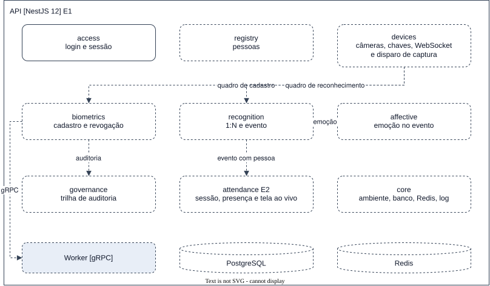

# API

`apps/api` · NestJS 12 sobre Fastify, Node 26 · estágio E1, com o módulo `attendance` no E2 · ainda
não existe.

## O que faz

É o único backend. Serve a API do gestor e do painel e mantém a conexão de cada câmera. Entrega o quadro
ao [Worker](worker.md), compara o vetor com a galeria e grava o resultado.

## O que nunca faz

- Carrega modelo ou chama runtime de inferência. Isso é do Worker.
- Grava o quadro em qualquer lugar ([BR-01](../../requirements/business-rules.md#br-01)).
- Coloca o quadro numa fila.

## Blocos internos

Ambiente, banco, Redis, log e a rota de saúde ficam em `src/core`. Cada área do SRS é um módulo Nest.
A política por rota do `@nestjs/authorization` entra quando existir um segundo papel ou uma regra por
recurso. Até lá o guard global do `@nestjs/authentication` basta, porque há um papel só.

| Módulo | Responsabilidade | Requisitos | Estágio |
| --- | --- | --- | --- |
| `access` | Login e sessão do gestor, com o guard global que nega por padrão ([spec](../../specs/3-manager-access/manager-session.md)) | FR-ACC-01, NFR-SEC-03 | E1 |
| `registry` | Pessoas | FR-REG-01 | E1 |
| `devices` | Câmeras, chaves, canal WebSocket e disparo de captura | FR-DEV-01 a 04, NFR-SEC-01, NFR-SEC-02 | E1 |
| `biometrics` | Cadastro biométrico e revogação | FR-BIO-01 a 04 | E1 |
| `recognition` | Comparação 1:N e evento de reconhecimento | FR-REC-01, FR-REC-02 | E1 |
| `affective` | Emoção gravada no evento | FR-AFF-01, FR-AFF-02 | E1 |
| `governance` | Trilha de auditoria | FR-GOV-01 | E1 |
| `attendance` | Sessão de chamada, presença e leitura da tela ao vivo | FR-ATT-01 a 04 | E2 |

## Para mudar com segurança

- A chamada ao Worker leva um prazo. A chamada vencida vira desfecho registrado
  ([NFR-PERF-01](../../requirements/non-functional/performance.md#nfr-perf-01)), e o resto da API segue
  atendendo ([NFR-REL-01](../../requirements/non-functional/reliability.md#nfr-rel-01)).
- A chave da câmera é conferida no handshake e em cada mensagem. Uma chave revogada fecha a conexão com
  o código `1008` ([0001](../../decisions/0001-stack-do-backend.md)).
- A cota usa um cliente Redis sem fila offline. Redis fora do ar responde `503`
  ([NFR-SEC-02](../../requirements/non-functional/security.md#nfr-sec-02)).
- O `openapi.json` gerado pelo Nest é o contrato do Painel. Mudar um schema de resposta muda os tipos
  do Painel.
