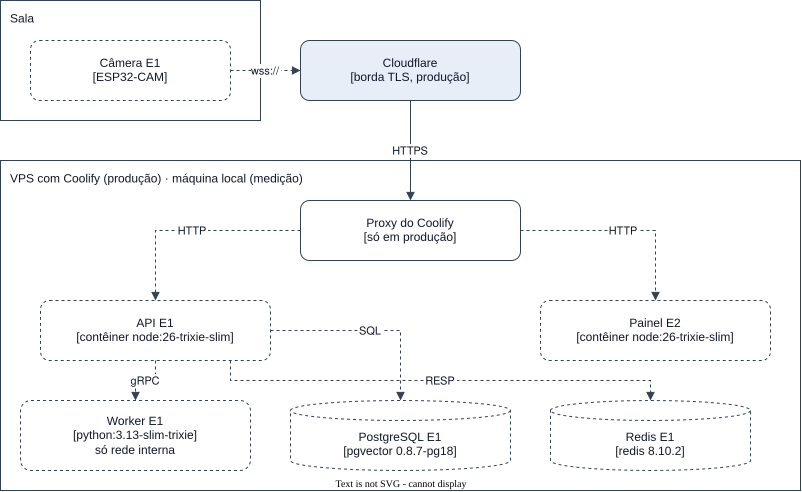

# Implantação e entrega

## Ambientes

Os dois ambientes rodam os mesmos artefatos de build
([NFR-FLEX-01](../requirements/non-functional/flexibility.md#nfr-flex-01)): as imagens da API, do
Painel e do Worker. O que muda entre eles é só a configuração
([0003](../decisions/0003-repositorio-e-infraestrutura.md)).

| | Local | Produção |
| --- | --- | --- |
| Para que serve | Medir | Demonstrar |
| Onde roda | Uma máquina na mesma rede da câmera | Uma VPS própria com Coolify, atrás da Cloudflare |
| TLS | A API serve HTTPS com a CA do projeto, fixada no firmware | A Cloudflare e o proxy do Coolify terminam o TLS |
| PostgreSQL e Redis | `infra/compose.dev.yaml`, portas em `127.0.0.1` | Recursos de banco do Coolify, com as mesmas imagens |
| Latência medida | Rede local | Inclui a internet |

A produção só recebe o sistema quando ele estiver completo.

## Onde cada bloco roda

| Bloco | Local | Produção | Estágio |
| --- | --- | --- | --- |
| Câmera | Na porta da sala | Na porta da sala, conectando ao domínio público da API | E1 |
| API | Processo Node fora do Docker | Contêiner do Dockerfile da API, com domínio público | E1 |
| Worker | Processo Python fora do Docker | Contêiner do Dockerfile do Worker, só na rede interna | E1 |
| PostgreSQL | Contêiner do compose de desenvolvimento | Recurso de banco do Coolify | E1 |
| Redis | Contêiner do compose de desenvolvimento | Recurso de banco do Coolify | E1 |
| Painel | Processo Node fora do Docker | Contêiner do Dockerfile do Painel, com domínio público | E2 |

Na produção, as migrations rodam no comando de pré-implantação do contêiner da API, com o papel
privilegiado do banco.

## Entrega

- Todo trabalho sai de uma branch cortada da `staging` e volta por Pull Request. A `main` recebe a
  release por merge commit.
- O CI roda os gates de cada área no GitHub Actions, com filtro de caminho
  ([0003](../decisions/0003-repositorio-e-infraestrutura.md)). Ainda não existe nenhum workflow. Os
  primeiros, o dos gates do `apps/api` e o do `gitleaks` sobre o histórico inteiro, vêm do
  [acesso do gestor](../specs/3-manager-access/manager-session.md).
- As branches não têm proteção configurada. A regra de Pull Request é uma convenção.
- As dependências são atualizadas à mão, com `bun outdated` e `uv`.
