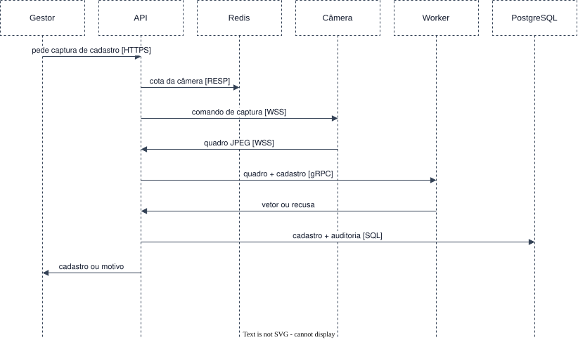

# Cadastrar o rosto de uma pessoa

Requisitos: [FR-DEV-04](../../requirements/functional/devices.md#fr-dev-04),
[FR-BIO-01 a 03](../../requirements/functional/biometrics.md),
[FR-GOV-01](../../requirements/functional/governance.md#fr-gov-01). Estágio E1.

Pré-condição: a pessoa e a câmera estão registradas, e a câmera está conectada.

1. **Gestor → API** (HTTPS): pede uma captura de cadastro de uma pessoa numa câmera.
2. **API**: autentica o gestor, autoriza a operação e aplica a cota da câmera no Redis.
3. **API → Câmera** (WebSocket sobre TLS): envia o comando de captura com a finalidade.
4. **Câmera → API**: captura o quadro e o devolve como mensagem binária.
5. **API → Worker** (gRPC, com prazo): entrega o quadro e a finalidade.
6. **Worker**: detecta o rosto, avalia qualidade e vivacidade e extrai o vetor. Uma recusa volta com o
   motivo e encerra o cenário sem cadastro.
7. **API → PostgreSQL**: grava o cadastro biométrico com o vetor e o registro de auditoria, na mesma
   transação.
8. **API → Gestor**: responde com o cadastro criado, ou com a recusa e o motivo.

O quadro deixa de existir ao fim do passo 6 e não aparece em nenhum passo seguinte.
