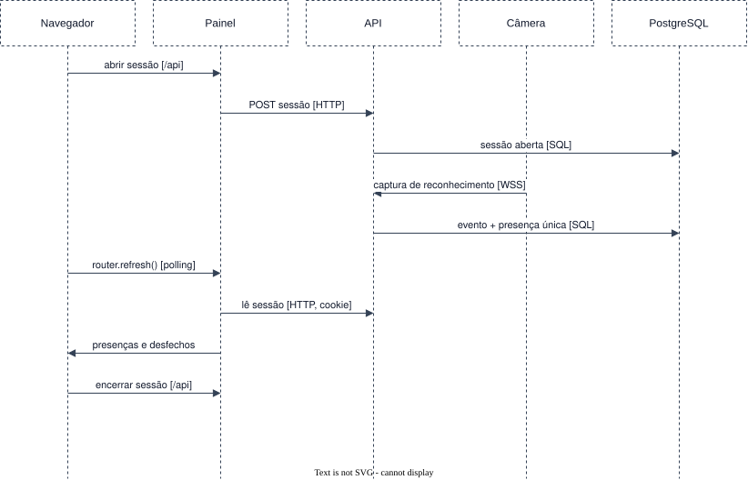

# Acompanhar a sessão de chamada ao vivo

Requisitos: [FR-ATT-01 a 04](../../requirements/functional/attendance.md),
[BR-04](../../requirements/business-rules.md#br-04). Estágio E2.

Pré-condição: o gestor está autenticado no Painel e a câmera está conectada.

1. **Navegador → Painel → API** (HTTPS, `/api` na mesma origem): o gestor abre a sessão de chamada na
   câmera. Se a câmera já tem uma sessão aberta, a API recusa com o motivo.
2. **Painel → API** (HTTP, com o cookie repassado): o Server Component da tela ao vivo lê a sessão, as
   presenças e os últimos desfechos de captura.
3. **Câmera → API → Worker → PostgreSQL**: cada captura de reconhecimento segue o cenário
   [reconhecer quem passa pela câmera](recognition.md).
4. **API → PostgreSQL**: quando o evento tem pessoa e a câmera tem sessão aberta, grava a presença,
   uma única vez por pessoa e sessão.
5. **Navegador → Painel**: em intervalos, `router.refresh()` repete o passo 2, e a tela mostra a
   pessoa, o instante e a emoção, ou o desfecho sem pessoa com o motivo.
6. **Navegador → Painel → API**: o gestor encerra a sessão. Os eventos seguintes da câmera não viram
   presença.

A emoção de uma pessoa identificável só sai da API para esta tela, junto da captura que a gerou.
