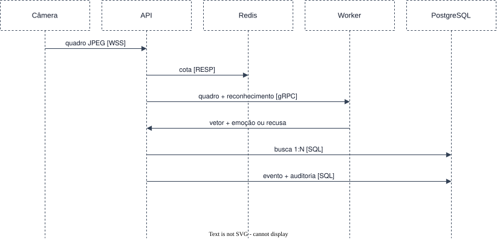

# Reconhecer quem passa pela câmera

Requisitos: [FR-REC-01 e 02](../../requirements/functional/recognition.md),
[FR-AFF-01 e 02](../../requirements/functional/affective.md),
[NFR-PERF-01](../../requirements/non-functional/performance.md#nfr-perf-01),
[NFR-REL-01](../../requirements/non-functional/reliability.md#nfr-rel-01). Estágio E1.

Pré-condição: a câmera está conectada e recebeu um comando de captura de reconhecimento
([FR-DEV-04](../../requirements/functional/devices.md#fr-dev-04)).

1. **Câmera → API** (WebSocket sobre TLS): envia o quadro como mensagem binária.
2. **API**: identifica a câmera pela conexão autenticada e aplica a cota no Redis.
3. **API → Worker** (gRPC, com prazo): entrega o quadro.
4. **Worker**: detecta o rosto, avalia qualidade e vivacidade, extrai o vetor e infere a emoção.
5. **API → PostgreSQL**: compara o vetor com a galeria (1:N).
6. **API → PostgreSQL**: grava o evento de reconhecimento e o registro de auditoria.
   - Com correspondência acima do limiar, o evento leva a pessoa, a confiança e a emoção.
   - Sem correspondência, ou com recusa no passo 4, o evento vai sem pessoa e com o motivo.

Desvios que o cenário precisa tratar:

- **Prazo estourado:** a chamada ao Worker é cancelada e o evento registra o estouro.
- **Worker indisponível:** a captura recebe um desfecho de erro registrado, e a API continua
  atendendo as outras operações.

O artigo mede o intervalo que vai do envio no passo 1 à gravação no passo 6.
