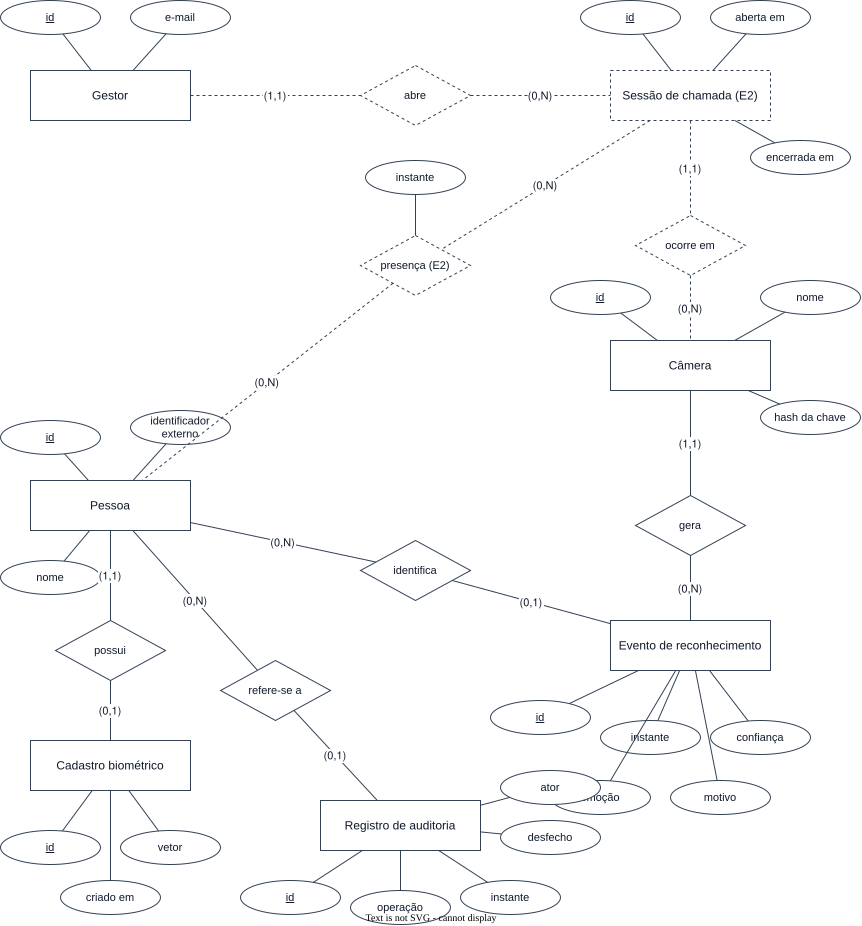

# Modelo de dados

O modelo conceitual do sistema decidido, derivado do [glossário](../requirements/glossary.md) e dos
requisitos. Nenhuma tabela existe ainda.

## Modelo conceitual

O que é do E2 aparece tracejado.

## Modelos lógico e físico

Os dois nascem com a primeira migration de `apps/api`. O físico é lido do catálogo de um banco com as
migrations aplicadas, e o lógico é derivado dele.

## Entidades

| Entidade | O que é uma instância | Estágio |
| --- | --- | --- |
| Gestor | Quem autentica e opera o sistema: e-mail, hash da senha e data de criação | E1 |
| Sessão do gestor | Um login aberto num navegador, com expiração absoluta e por inatividade | E1 |
| Pessoa | Alguém que pode ter o rosto cadastrado: identificador externo e nome | E1 |
| Câmera | Uma ESP32-CAM registrada, com chave própria | E1 |
| Cadastro biométrico | O vínculo entre uma pessoa e o vetor do rosto dela | E1 |
| Evento de reconhecimento | O desfecho de uma captura de reconhecimento, com ou sem pessoa | E1 |
| Registro de auditoria | O rastro de uma operação sobre dado biométrico | E1 |
| Sessão de chamada | O intervalo em que os eventos de uma câmera viram presença | E2 |

A presença é a relação entre Sessão de chamada e Pessoa, com o instante. Ela não é uma entidade.

## Invariantes

- O e-mail de um gestor é único e guardado em minúsculas.
- Uma sessão do gestor guarda só o SHA-256 do token, e some quando o gestor é apagado.
- Uma pessoa tem no máximo um cadastro biométrico.
- Revogar o cadastro deixa o vetor irrecuperável
  ([FR-BIO-04](../requirements/functional/biometrics.md#fr-bio-04)).
- O identificador externo de uma pessoa é único
  ([FR-REG-01](../requirements/functional/registry.md#fr-reg-01)).
- De uma pessoa, os únicos dados cadastrais são o identificador externo e o nome
  ([BR-05](../requirements/business-rules.md#br-05)).
- Um evento de reconhecimento sem pessoa não guarda vetor
  ([FR-REC-02](../requirements/functional/recognition.md#fr-rec-02)).
- A emoção, com o rótulo e a confiança, fica no próprio evento
  ([FR-AFF-02](../requirements/functional/affective.md#fr-aff-02)).
- Uma câmera tem no máximo uma sessão de chamada aberta
  ([FR-ATT-01](../requirements/functional/attendance.md#fr-att-01)).
- Existe no máximo uma presença por pessoa e sessão
  ([FR-ATT-03](../requirements/functional/attendance.md#fr-att-03)).
- Um registro de auditoria guarda o ator, o instante e o recurso, e nunca é alterado nem apagado
  ([FR-GOV-01](../requirements/functional/governance.md#fr-gov-01)).
- Nenhuma entidade guarda o quadro ([BR-01](../requirements/business-rules.md#br-01)).

## Conteúdo

| Arquivo | O que guarda |
| --- | --- |
| [access-patterns.md](access-patterns.md) | As operações que o modelo precisa servir |
| [storage.md](storage.md) | O armazenamento físico |
