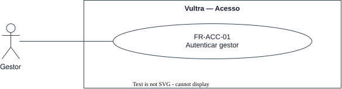

# ACC — Acesso

Quem autentica no sistema. Só o gestor autentica; a pessoa reconhecida não opera o sistema.

## FR-ACC-01 — Autenticar gestor

> Como gestor, quero me autenticar, para operar o sistema pela API e pela tela ao vivo.

O sistema deve autenticar um gestor antes de qualquer operação sobre pessoas, câmeras, cadastros
biométricos e sessões de chamada.

| Atributo | Valor |
| --- | --- |
| Rationale | Criar pessoa, registrar câmera, disparar captura, revogar e abrir sessão precisam de um chamador autenticado já no núcleo |
| Source | Theo, entrevista de 2026-10-06 |
| Priority | Must |
| Status | approved |
| Milestone | E1 |
| Since | v1.0.0 |

**Critérios de aceite**
- **FR-ACC-01.1** — Dado um gestor com credencial válida, quando ele se autentica, então consegue
  operar pessoas, câmeras, cadastros biométricos e sessões de chamada.
- **FR-ACC-01.2** — Dada uma credencial inválida, quando a autenticação é tentada, então é recusada sem
  revelar se o usuário existe.
